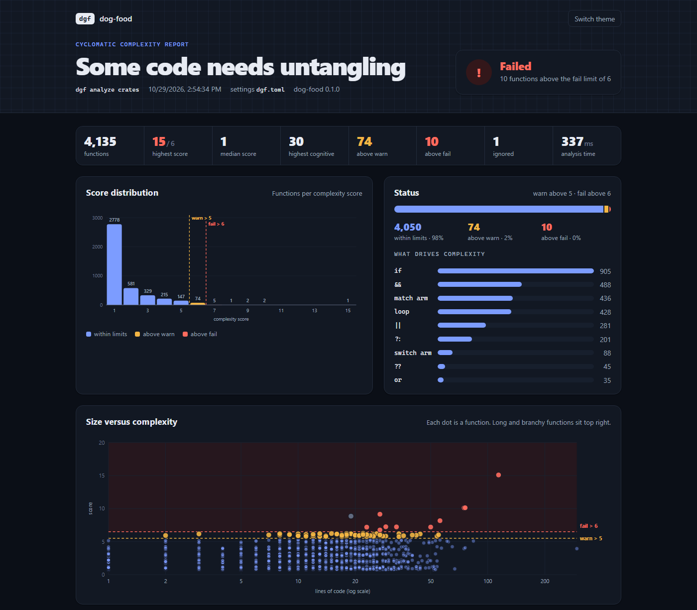
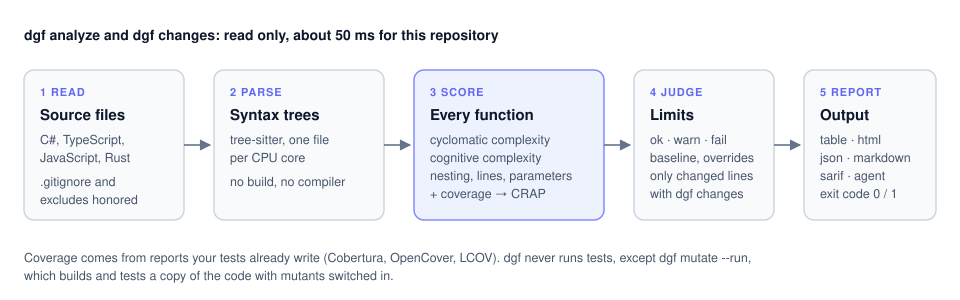
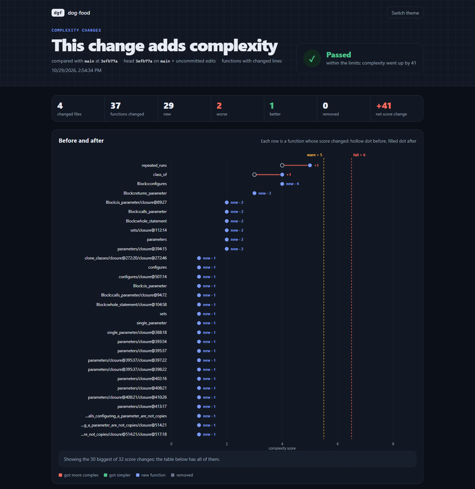
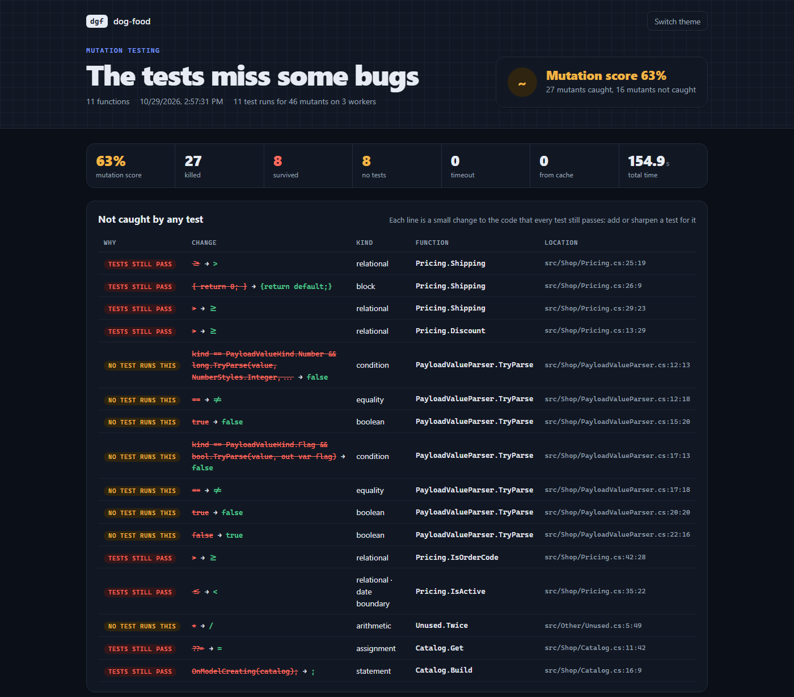
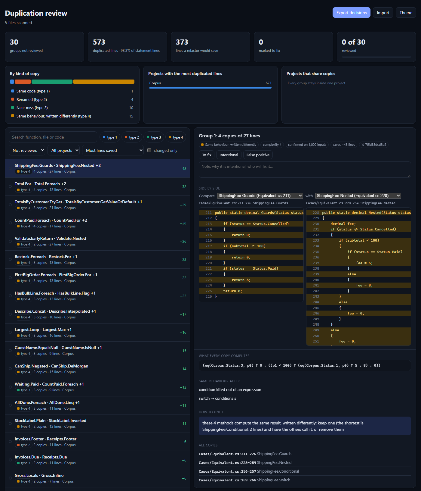

# dog-food

**dog-food** shows where a codebase is hard to change safely, and why. It reads **C#, TypeScript/JavaScript and Rust**, runs as one fast binary called **`dgf`**, and can fail a build when code gets worse.

It answers four questions:

| Question | Command | Guide |
| --- | --- | --- |
| Which functions are too complex, and which of those are untested? | `dgf analyze` | [Complexity and CRAP](#complexity-and-crap) |
| Did this branch make anything worse? | `dgf changes` | [Checking a branch](#checking-a-branch) |
| Would the tests notice a bug? | `dgf mutate --run` | [Mutation testing](#mutation-testing) |
| What code is copied, and how do I unite it? | `dgf dup` | [Duplication](#duplication) |



Apart from `dgf mutate --run`, which builds and tests a copy of your code, `dgf` only reads files and never changes them. It is fast: this repository (4,000 functions) takes under half a second ([benchmarks](docs/benchmarks.md)). The name comes from *dogfooding*: the tool checks its own source with the limits it enforces on others.

## Install

```powershell
cargo install --git https://github.com/bojanrmv/bt-dog-food dog-food-cli --locked
dgf --version
```

You need Rust and a C compiler once. Per-system steps, updating and the optional parts are in **[docs/install.md](docs/install.md)**.

## Quick start

```powershell
cd your-repo
dgf init                                       # a commented dgf.toml: limits, excludes, coverage
dgf analyze                                    # worst functions first
dgf analyze --format html -o dgf-report.html   # the full picture in a browser
dgf changes                                    # only what your branch changed, before and after
```

To set it up in a repository step by step, or to hand the setup to a colleague or an AI assistant: [docs/setup-in-another-repo.md](docs/setup-in-another-repo.md).

## Complexity and CRAP

```
$ dgf analyze src --coverage TestResults
COMPLEXITY  COGNITIVE  STATUS   COVERAGE    CRAP  FUNCTION          LOCATION
        11         15  FAIL           0%   132.0  Pricing.Shipping  src/Shop/Pricing.cs:20-34
         8          5  warn          91%     8.0  Pricing.Discount  src/Shop/Pricing.cs:5-18
```

Every function gets:

| Metric | What it tells you |
| --- | --- |
| **Cyclomatic complexity** | the number of independent paths: 1 + every `if`, loop, `case`, `catch`, `?:`, `&&`, `\|\|`. The limits apply to this one. |
| **Cognitive complexity** | how hard it is to read: branches cost more the deeper they are nested |
| **Nesting, lines, parameters** | the function's shape |
| **CRAP** | with a coverage report: complexity² × (1 − coverage)³ + complexity. High means complex *and* untested. |



More: [how each metric is counted](docs/metrics.md) · [coverage and CRAP](docs/coverage.md) · [limits and dgf.toml](docs/configuration.md).

## Checking a branch

`dgf changes` compares your branch and uncommitted edits with its base branch, and fails only on functions that are new or got worse. Old code can stay as it is.

```powershell
dgf changes                       # what this branch did
dgf hook install                  # check every commit before it is made
dgf baseline                      # accept today's code, so only new problems fail
```



More: [workflows: branches, hooks, baselines, history, CI](docs/workflows.md).

## Mutation testing

`dgf mutate` makes small bugs in your code (`>=` → `>`, `true` → `false`, a removed statement) and runs your tests against each. A bug the tests miss is a test to write. C# (xUnit, NUnit, MSTest) and TypeScript/JavaScript (Vitest, Jest).

```powershell
dgf mutate --changes              # which functions, how many mutants (instant)
dgf mutate --changes --run        # build, test, list what the tests miss
```



More: [mutation testing](docs/mutation-testing.md).

## Duplication

`dgf dup` finds copied code and says how to unite it: exact and renamed copies, near misses, the same statements in another order, and long expressions copied into different statements. For C#, `--semantic` adds methods that do the same thing written differently (a loop and its LINQ), repeated database queries, and runs each claim on generated inputs with `--confirm`.

```powershell
dgf dup                           # biggest wins first
dgf dup --format html -o dup.html # review and mark each group
dgf dup --changes --fail-on-copies # fail a PR that adds a copy
```



More: [duplication](docs/duplication/README.md).

## Reports

Every command writes a terminal table by default, and with `--format`:

| Format | For |
| --- | --- |
| `html` | people: one page with charts, offline, light and dark ([the dashboards](docs/dashboards.md)) |
| `markdown` | PR comments, CI job summaries |
| `json` | other tools; carries a `schemaVersion` |
| `sarif` | GitHub code scanning, editors |
| `agent` | AI assistants: only what needs attention |

Exit codes: 0 within the limits, 1 above them, 2 a usage error, 3 a missing path, 4 a mutation run out of time. More: [command reference](docs/commands.md).

## Documentation

| Topic | Page |
| --- | --- |
| Installing, updating, optional parts | [install.md](docs/install.md) |
| Setting up a repository | [setup-in-another-repo.md](docs/setup-in-another-repo.md) |
| Every command and option | [commands.md](docs/commands.md) |
| `dgf.toml`, limits, excludes, comments in code | [configuration.md](docs/configuration.md) |
| How each metric is counted | [metrics.md](docs/metrics.md) |
| Coverage and CRAP | [coverage.md](docs/coverage.md) |
| Branches, hooks, baselines, history, CI | [workflows.md](docs/workflows.md) |
| The HTML dashboards | [dashboards.md](docs/dashboards.md) |
| Mutation testing | [mutation-testing.md](docs/mutation-testing.md) |
| Duplication | [duplication/](docs/duplication/README.md) |
| VS Code, AI assistants, the Rust library | [integrations.md](docs/integrations.md) |
| Design and decisions | [architecture.md](docs/architecture.md) |
| Speed | [benchmarks.md](docs/benchmarks.md) |
| Building, testing, adding a language | [development.md](docs/development.md) |
| What comes next | [roadmap.md](docs/roadmap.md) |

## License

[MIT](LICENSE): free to use, change and share, commercially too. dgf is maintained in spare time, on a best-effort basis, and comes without any warranty.
