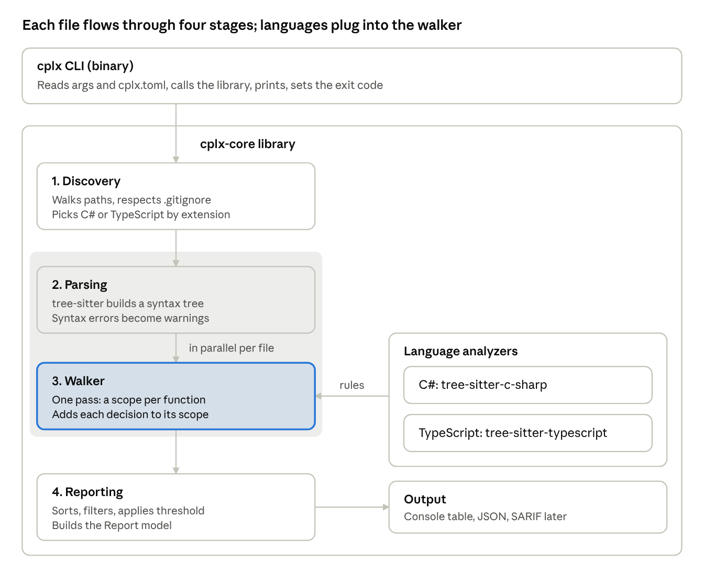

# dog-food — Architecture PRD

Oct 22, 2026 · @Bojan · Living copy: https://claude.ai/artifact/GPbwaTdQKAzRkqkPBd2bQc

## Overview

We are building a fast, single-binary Rust library and CLI that reads C# and TypeScript source code and reports the cyclomatic complexity of every method, meaning how many independent paths it can take. The tool is called **dog-food**; its command is `dgf`. The name comes from dogfooding: the tool analyzes its own Rust source from day one.

**Problem.** Complexity tools exist (the ESLint `complexity` rule, the Roslyn analyzer CA1502, SonarQube, lizard), but each is tied to one ecosystem or is heavy to run. Teams with both C# and TypeScript get two tools, two sets of counting rules and runs too slow for pre-commit hooks or editors.

**Product.** One engine that parses source with tree-sitter, counts decision points per method using documented rules, and outputs a console table, JSON, or a failing exit code. Test coverage is out of scope; a coverage or mutation report may later be accepted as an optional input.

**Goals**

- Accurate, documented per-method cyclomatic complexity for C# and TypeScript (including TSX and JS).
- Fast enough to run on every save or commit, even in large monorepos.
- One self-contained binary with no .NET or Node runtime needed.
- Stable JSON output other tools and CI can consume.
- A clean core that new languages and metrics can plug into.

**Non-goals (for v1)**

- Running tests or producing coverage.
- Type-aware or semantic analysis (we read syntax only).
- Auto-fixing or refactoring code.
- A hosted service or dashboard.

## Core concept: cyclomatic complexity

A method's complexity is 1 plus the number of decision points in it. Thomas McCabe defined it in 1976 as the number of linearly independent paths through a method's control-flow graph:

```
M = E - N + 2P
```

E is edges, N is nodes and P is connected components. For one method, this equals 1 plus each branch. We count from the syntax tree, so we never build the graph.

```csharp
int Classify(int x)
{
    if (x < 0) return -1;      // +1
    if (x == 0) return 0;      // +1
    return x > 100 ? 2 : 1;    // +1
}
// complexity = 1 + 3 = 4  → 4 paths, at least 4 test cases
```

**Risk bands** (common industry bands, configurable): 1–10 low, 11–20 moderate, 21–50 high, 51+ very high.

**Relation to CRAP.** CRAP (Change Risk Anti-Patterns, Savoia and Evans, 2007) combines complexity with test coverage: CRAP = comp² × (1 − cov)³ + comp. We build the complexity half. CRAP becomes possible later if a coverage file is passed in as an optional input.

References: [McCabe, "A Complexity Measure" (1976)](https://www.cs.mtsu.edu/~untch/6050/private/McCabe1976.pdf) · [Savoia, "This Code is CRAP" (2011)](https://testing.googleblog.com/2011/02/this-code-is-crap.html)

## Architecture overview

The CLI is a thin shell; all the work happens in the `dog-food-core` library, which runs each file through four stages.



Parsing and walking run per file in parallel. Language analyzers only supply rules (which nodes are functions and which are decisions); the shared walker does the counting, so adding a language never touches the pipeline.

## Components

Each component has one job and talks to the next through plain data types. The core library never prints or touches the terminal; only the CLI does.

**1. Discovery** (`discover`)

- Walks the target paths with the `ignore` crate, so `.gitignore`, `bin/`, `obj/` and `node_modules/` are skipped for free.
- Picks a language by file extension: `.cs` → C#; `.ts`, `.tsx`, `.js`, `.jsx`, `.mts`, `.cts` → TypeScript.
- Applies user include and exclude globs and skips generated files (`*.g.cs`, `*.Designer.cs`, `*.d.ts`).
- Output: a list of `SourceFile { path, language }`.

**2. Parsing** (`parse`)

- Reads each file and hands it to tree-sitter with the right grammar, producing a concrete syntax tree.
- tree-sitter tolerates errors: a file with a syntax error still parses, and broken regions become `ERROR` nodes. We record a warning and keep going.
- One `Parser` per worker thread (parsers are not shared between threads).

**3. Language analyzers** (`lang::csharp`, `lang::typescript`)

The heart of the library. Each language implements one trait:

```rust
pub trait LanguageAnalyzer: Send + Sync {
    fn language(&self) -> Language;
    fn grammar(&self) -> tree_sitter::Language;
    /// Node kinds that start a new function scope (method, lambda, ...).
    fn is_function(&self, node: &Node) -> bool;
    /// How much a node adds to complexity (0 if none), and under which category.
    fn decision(&self, node: &Node, src: &[u8]) -> Option<Decision>;
    /// Human-readable name, e.g. "OrderService.CalculateDiscount".
    fn qualified_name(&self, node: &Node, src: &[u8]) -> String;
}
```

A shared walker does the traversal: it walks the tree once, opens a new scope at each function node, and adds each decision to the innermost open scope. Languages only describe *what* counts; the walker owns *how* counting works.

**4. Metrics model** (`model`)

- `FunctionMetrics`: file, qualified name, kind, start and end line, complexity, and a breakdown by category.
- `FileReport` and `Report`: per-file and totals, plus warnings (parse errors, skipped files) and timing.

**5. Reporting** (`report`)

- Sorts, filters (`--top`, `--min`), and serializes the `Report`.
- Formats: console table (default), JSON, later SARIF (GitHub code scanning) and HTML.

**6. CLI** (`dgf` binary)

- Thin wrapper using `clap`: parses args, loads config (`dgf.toml`), calls the library, prints, and sets the exit code.
- Example: `dgf analyze ./src --format json --threshold 15`

## Counting rules

Every method starts at 1, and each construct below adds 1. The rules match the widely used McCabe variant (as in ESLint and SonarQube cyclomatic mode), so results can be checked against those tools. Node kind names are from the tree-sitter grammars and must be confirmed against the grammar versions we pin.

| Construct | C# node kind | TypeScript node kind | Counted |
| --- | --- | --- | --- |
| `if` / `else if` | `if_statement` | `if_statement` | Yes (`else` alone: no) |
| `for` | `for_statement` | `for_statement` | Yes |
| `foreach` / `for…of` / `for…in` | `foreach_statement` | `for_in_statement` | Yes |
| `while` | `while_statement` | `while_statement` | Yes |
| `do … while` | `do_statement` | `do_statement` | Yes |
| `case` label | `case` labels in a `switch_section` | `switch_case` | Yes, each label (`default`: no) |
| Switch expression arm | `switch_expression_arm` | n/a | Yes, every arm but the last |
| `catch` | `catch_clause` | `catch_clause` | Yes |
| Ternary `?:` | `conditional_expression` | `ternary_expression` | Yes |
| `&&` and `\|\|` | `binary_expression` | `binary_expression` | Yes, each operator |
| `??` | `binary_expression` | `binary_expression` | Yes |
| `?.` | `conditional_access_expression` | `optional_chain` | No |
| `&&=` `\|\|=` `??=` | `assignment_expression` | `augmented_assignment_expression` | No (for now) |
| Pattern `and` / `or` | `and_pattern` / `or_pattern` | n/a | Yes |
| `goto`, `break`, `continue`, `return` | various | various | No |

**Function scopes.** These start their own count and do not add to the enclosing method:

- C#: methods, constructors, destructors, operators, property and indexer accessors, local functions, lambdas, anonymous methods.
- TypeScript: function declarations and expressions, arrow functions, class methods, getters and setters, object literal methods.

Nested lambdas are reported as separate entries named after their parent (for example `OrderService.Apply/lambda@57`). An option to fold them into the parent can come later.

## Data model and output

The JSON format is the library's public contract: it is versioned (`schemaVersion`) and only changes in backward-compatible ways within a major version.

```json
{
  "schemaVersion": 1,
  "tool": { "name": "dog-food", "version": "0.1.0" },
  "summary": {
    "files": 1284, "functions": 9431, "durationMs": 410,
    "maxComplexity": 23, "overThreshold": 9
  },
  "functions": [
    {
      "file": "src/Core/Classifier.cs",
      "language": "csharp",
      "name": "Classifier.Classify",
      "kind": "method",
      "startLine": 8, "endLine": 13,
      "complexity": 4,
      "breakdown": { "if": 2, "ternary": 1 }
    }
  ],
  "warnings": [
    { "file": "src/Legacy/Old.cs", "message": "syntax error at 41:7, partial result" }
  ]
}
```

The numbers above are examples only.

**Console output.** A table of the top N functions sorted by complexity, colored by risk band, followed by a one-line summary.

**Exit codes**

| Code | Meaning |
| --- | --- |
| 0 | Success, no function above `--threshold` |
| 1 | At least one function above `--threshold` |
| 2 | Usage or configuration error |
| 3 | I/O error (path not found, unreadable file) |

## Performance design

Speed is the main reason this project uses Rust, so the design avoids anything that serializes work or copies data.

- **No runtime startup.** A native binary starts in milliseconds; there is no .NET or Node startup and no JIT warm-up.
- **Parallel per file.** Files are independent, so discovery feeds a `rayon` parallel iterator. Each worker owns its own tree-sitter `Parser` (thread-local), parses, walks and drops the tree.
- **One pass per tree.** A single cursor-based walk (`TreeCursor`) finds functions and counts decisions together; no second traversal, no recursion depth limits.
- **Little allocation.** Source bytes are read once; names are built only for functions we report. Syntax trees are dropped as soon as a file is done, so memory stays flat no matter the repo size.
- **Streaming results.** Per-file results are collected without a global lock and sorted once at the end.
- **Measured, not assumed.** `criterion` micro-benchmarks for the walker plus an end-to-end benchmark (`hyperfine`) on large public repos. Every performance change is checked against them.

**Targets** (to confirm with the first benchmark):

| Scenario | Target |
| --- | --- |
| Single file, editor or pre-commit use | under 10 ms |
| Medium repo, about 1,000 files | under 1 s |
| Compared with `eslint --rule complexity` on the same TS repo | at least 10× faster |

Benchmark candidates: the TypeScript compiler repo (TS) and the Roslyn or ASP.NET Core repo (C#).

## Extensibility

The core stays small; growth happens behind three seams.

- **New languages.** Add a tree-sitter grammar crate and one `LanguageAnalyzer` implementation (function node kinds, decision node kinds, naming). The walker, model and reporters stay untouched. Likely next candidates: Java, Go, Python, Rust.
- **New metrics.** The walker emits per-function events, and a metric is a visitor over them. Candidates: cognitive complexity (SonarSource; adds penalties for nesting), max nesting depth, function length in lines, parameter count.
- **Optional external inputs.** A `--coverage <file>` input (Cobertura, LCOV) or `--mutation <file>` input (the mutation-testing-elements JSON) would be joined to functions by file and line range. That would enable CRAP and "complex but weakly tested" reports without the tool ever running tests.
- **New output formats.** Reporters only consume the `Report` model, so SARIF, HTML or a JUnit-style XML for CI dashboards are self-contained additions.

## Distribution

One Rust core, several thin wrappers. Only the first two are in scope for v1.

| Channel | How | Users | When |
| --- | --- | --- | --- |
| Rust crate | `dog-food-core` on crates.io | Rust tools embedding the engine | v1 |
| CLI binary | Prebuilt for Windows, Linux, macOS (x64, arm64) via `cargo-dist` and GitHub Releases | Everyone, CI | v1 |
| npm package | Native Node module via `napi-rs`, or the CLI binary per platform (the Biome and SWC model) | TS developers: `npx dgf` | v2 |
| .NET tool | `dotnet tool install dog-food`, wrapping the platform binary | C# developers | v2 |
| WebAssembly | `wasm-bindgen` build of the core | VS Code extension, browser playground | Later |

The core library has no I/O assumptions (it accepts paths or in-memory source text), so the WASM and editor builds need no forks.

## Testing strategy

Correctness of the numbers is the product, so most effort goes into fixture tests that pin every counting rule.

1. **Unit tests** (`#[test]` next to the code): one test per counting rule per language, on tiny inline snippets.
2. **Fixture tests** (`tests/fixtures/`): real-looking `.cs` and `.ts` files where each function carries its expected value in a comment, e.g. `// dgf: 7`. One test runner reads the comments and compares; adding a case means adding a file.
3. **Snapshot tests** (`insta`): the full JSON and console output for the fixture folder, so any change in output shows up as a reviewable diff.
4. **Cross-checks**: run ESLint's `complexity` rule on the TS fixtures and compare. Differences must be explained by a documented rule choice.
5. **Robustness**: files with syntax errors, empty files, huge generated files, non-UTF-8 bytes. The tool must never panic; at worst it reports a warning.
6. **Property and fuzz tests** (later, `proptest` / `cargo-fuzz`): random input must never crash the walker.
7. **Benchmarks** in CI: a large regression in the end-to-end benchmark fails the build.

## Tech stack and repository layout

| Concern | Choice | Why |
| --- | --- | --- |
| Language | Rust (stable, 2021 edition) | Speed, single binary, safe parallelism |
| Parsing | `tree-sitter`, `tree-sitter-c-sharp`, `tree-sitter-typescript` | One API for both languages, fast, tolerant of errors |
| File walking | `ignore` | Respects `.gitignore`, parallel walker (from ripgrep) |
| Parallelism | `rayon` | Data parallelism with one-line changes |
| CLI | `clap` | Standard Rust argument parsing |
| Serialization | `serde`, `serde_json`, `toml` | JSON output, `dgf.toml` config |
| Errors | `thiserror` (library), `anyhow` (CLI) | Typed errors in the library, simple ones in the binary |
| Testing | `insta`, `criterion`, `hyperfine` | Snapshots, micro- and end-to-end benchmarks |
| Release | `cargo-dist`, GitHub Actions | Cross-platform binaries |

A Cargo workspace keeps the library and the CLI separate from day one, so the library never depends on CLI-only crates.

```text
CRAP/
  Cargo.toml                 # workspace
  docs/                      # this document, decisions (ADRs), counting rules
  crates/
    dog-food-core/               # the library
      src/
        lib.rs               # public API: analyze_paths(), analyze_source()
        discover.rs
        parse.rs
        walker.rs            # shared tree walk and scope stack
        model.rs
        report/              # console.rs, json.rs
        lang/
          mod.rs             # LanguageAnalyzer trait, Language enum
          csharp.rs
          typescript.rs
      tests/
        fixtures/            # csharp/*.cs, typescript/*.ts with expected values
        fixtures.rs
    dog-food-cli/                # the `dgf` binary
      src/main.rs
  benches/
```

## Roadmap

Milestones run in order; each one ends with something that works and has tests. No dates yet; we set them after M1 shows real velocity.

1. **M0 — Toolchain and skeleton.** Install Rust and the MSVC build tools, set up the workspace, CI running `cargo fmt`, `clippy` and `test`.
   - Done when: `cargo test` passes in CI on an empty library.
2. **M1 — TypeScript, one file.** Parse a `.ts` file, list functions with line ranges, count decisions, fixture tests for every TS rule.
   - Done when: all TS fixture tests pass and results match ESLint `complexity` on the fixtures.
3. **M2 — C#.** Second `LanguageAnalyzer`, C# fixtures, shared walker proven on two grammars.
   - Done when: all C# fixture tests pass.
4. **M3 — Whole repo and CLI.** Discovery, `rayon`, console and JSON output, `--threshold`, exit codes, `dgf.toml`.
   - Done when: `dgf analyze` runs on a real repo and its output is snapshot-tested.
5. **M4 — Benchmarks and v0.1 release.** End-to-end benchmark against ESLint, performance pass, prebuilt binaries on GitHub Releases.
   - Done when: the performance targets are met or the gap is understood and written down.
6. **Later:** npm and .NET wrappers, SARIF output, cognitive complexity, optional coverage or mutation input.

## Open questions

- [x] **Name.** Product `dog-food` (crates `dog-food-core`, `dog-food-cli`), command `dgf`. All free on crates.io and npm as of Oct 22, 2026. `df` was rejected: it clashes with the Unix disk-space command.
- [x] **Null-coalescing.** `??` adds 1 in C# and TypeScript: it is a real branch.
- [x] **Optional chaining.** `?.` does not add 1: counting it inflates scores in modern TS and C# without adding much risk.
- [x] **Pattern combinators.** C# `and` / `or` patterns add 1 each, like `&&` / `||`.
- [ ] **Logical assignment** (`&&=`, `||=`, `??=`): not counted yet. Count them?
- [x] **Switch counting.** Each `case` label adds 1, even when labels share a body. Switch expressions and Rust `match` add arms minus 1.
- [x] **Lambdas.** Reported separately, named after their parent (`Cart.Run/abs`, `outer/closure@12:9`). Folding into the parent may become an option.
- [x] **Default limits.** `warn` above 10 by default and no `fail`; projects set both in `dgf.toml` (this repo: warn 5, fail 6).
- [ ] **Generated code.** Which patterns are skipped by default beyond `*.g.cs`, `*.Designer.cs` and `*.d.ts`?
- [ ] **Library API shape.** Return the whole `Report`, stream per-file results through a callback, or both?
- [ ] **License.** MIT, Apache-2.0, or both (the Rust convention)?

## Status (Oct 22, 2026)

Built beyond the original plan, in the order users asked for it. Guides: [metrics](metrics.md), [coverage](coverage.md), [workflows](workflows.md), [integrations](integrations.md), [benchmarks](benchmarks.md).

| Area | State |
| --- | --- |
| Languages | C#, TypeScript/JavaScript (TS, TSX, JS, JSX), Rust |
| Metrics | Cyclomatic (limits), cognitive, max nesting, lines, parameters; coverage and CRAP from Cobertura or LCOV |
| Commands | `analyze`, `changes` (branch or `--staged` vs base), `history`, `baseline`, `hook`, `skill`, `init` |
| Outputs | table, JSON, Markdown, HTML (analyze, changes, history pages), SARIF, `agent` (compact text for AI) |
| Excusing code | `// dgf-ignore: reason` above a function; `.dgf/baseline.json` |
| Integrations | GitHub Actions workflow (self-check, PR changes, SARIF), pre-commit hook, VS Code extension, Claude Code skill |

Decisions made along the way:

- **Cognitive complexity counts the `else` keyword token** instead of finding `else` branches through parent lookups: tree-sitter's `parent()` walks from the root and made the engine 2× slower ([benchmarks](benchmarks.md)).
- **Lambdas and closures are scored separately**, also for cognitive complexity (SonarSource nests them into their parent).
- **Limits apply to cyclomatic complexity**; a CRAP score above `crap_warn`/`crap_fail` raises the status too. Cognitive complexity is reported, not limited.
- **`dgf changes` fails only on new or worse functions by default**, so touching old debt does not block a change.
- **The skill is compiled into the binary**, so `dgf skill install` always matches the installed `dgf`.
