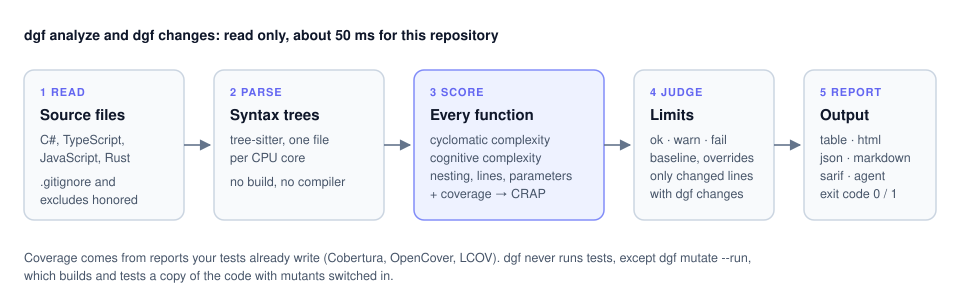

# Architecture

How dog-food is built and why. To use it, start with the [README](../README.md); to change it, see [development](development.md).

## Overview

`dog-food` is a Rust library and CLI (`dgf`) that scores every function in C#, TypeScript/JavaScript and Rust for complexity and CRAP, finds duplicated code, and tests the tests with mutation runs. The name comes from dogfooding: this repository is checked by its own tool.

**Goals**

- Documented per-function scores, from counting rules anyone can check.
- Fast enough to run on every save or commit, even in large monorepos.
- One native binary. Complexity needs no .NET or Node runtime; the C# duplication engine needs .NET 10, and mutation runs need the project's own toolchain.
- Stable JSON output that other tools and CI can consume.
- A core that new languages can plug into.

**Non-goals**

- Auto-fixing or refactoring code.
- A hosted service.

Complexity scores come from syntax alone. The C# duplication engine uses the compiler, and `dgf mutate --run` and `dgf dup --confirm` run your code.

## Scoring pipeline



The CLI finds files, applies settings and writes reports. `dog-food-core` does the parsing and scoring, and never prints. Files are independent, so they are parsed and scored in parallel. Language analyzers only supply rules: the shared walker does the counting, so adding a language does not touch the pipeline.

**Discovery** (`dog-food-cli/src/discover.rs`)

- Walks the target paths with the `ignore` crate, honoring `.gitignore`.
- Picks a language by extension: `.cs` is C#; `.rs` is Rust; `.ts`, `.mts`, `.cts`, `.js`, `.mjs` and `.cjs` are TypeScript; `.tsx` and `.jsx` are TSX.
- Applies excludes and skips generated files (`*.g.cs`, `*.Designer.cs`, `*.d.ts`).

**Parsing** (`dog-food-core/src/lib.rs`)

- Hands each file to tree-sitter with the right grammar. tree-sitter tolerates errors: broken regions become `ERROR` nodes, and the result has `has_errors` set.
- Each parse makes its own `Parser`. A file with syntax errors is parsed again in forms the grammar knows (`lang/prepare.rs`).

**Language analyzers** (`lang::csharp`, `lang::typescript`, `lang::rust`)

Each language implements one trait:

```rust
pub(crate) trait LanguageAnalyzer: Sync {
    fn grammar(&self) -> tree_sitter::Language;
    /// The source rewritten, at the same length, into syntax the grammar knows.
    fn prepare(&self, _source: &str) -> Vec<String> { Vec::new() }
    /// `Some(kind)` if this node starts a new function scope.
    fn function_kind(&self, node: Node) -> Option<&'static str>;
    /// `Some(category)` if this node is a decision point.
    fn decision(&self, node: Node, src: &[u8]) -> Option<&'static str>;
    /// How much a decision node adds; 1 unless one node holds several decisions.
    fn weight(&self, _node: Node) -> u32 { 1 }
    /// Name of a function node, without its enclosing functions.
    fn name(&self, node: Node, src: &[u8]) -> String;
    /// Whether this node is a branch or loop that nests (cognitive complexity).
    fn nests(&self, _node: Node) -> bool { false }
}
```

**Walker** (`walker.rs`). It walks the tree once, opens a scope at each function node, and adds each decision to the innermost open scope. Languages describe *what* counts; the walker owns *how* counting works. The rules for each language are in [metrics](metrics.md).

**Model** (`model.rs`). `FunctionMetrics` holds the file, qualified name, kind, lines, complexity with its breakdown by category, cognitive complexity, maximum nesting, parameters and whether it is ignored. `FileReport` holds one file's functions. The CLI's `Run` adds totals, warnings and timing.

**Reports** (`dog-food-cli/src/report`). Table, JSON, Markdown, HTML, SARIF and agent output, all from the same `Run`.

## The other engines

**Duplication** (`dog-food-dup`) has two engines that run at the same time and write one report: a syntactic one in Rust for every language, and a C# one on Roslyn (`semantic/`, .NET), started as a separate process. See [how the syntactic engine works](duplication/how-it-works.md) and [the C# engine](duplication/csharp.md).

**Mutation runs** live in `dog-food-cli/src/mutation`, and the mutants themselves in `dog-food-core/src/mutate`. See [how mutation testing works](mutation/how-it-works.md).

## Output contract

The JSON is what other tools rely on. It carries `schemaVersion`, and its top level has `tool`, `generatedAt`, `paths`, `config`, `summary`, `coverage`, `functions` and `warnings`. The summary has `files`, `functions`, `durationMs`, `maxComplexity`, `limits`, `pathOverrides`, `ok`, `warn`, `fail`, `ignored`, `maxCognitive` and `crapLimits`.

Exit codes are in the [command reference](commands.md#exit-codes).

## Performance

Speed is the main reason this project uses Rust.

- **No runtime startup.** A native binary starts in milliseconds, with no JIT warm-up. The .NET tool's command is that binary, not a wrapper.
- **Parallel per file.** Discovery feeds a `rayon` parallel iterator.
- **One pass per tree.** A single walk finds functions and counts decisions together.
- **Flat memory.** Syntax trees are dropped as soon as a file is done.
- **Measured.** With `examples/bench.rs` and timed runs: [benchmarks](benchmarks.md).

## Extensibility

- **New languages.** A tree-sitter grammar crate and one `LanguageAnalyzer`: [adding a language](development.md#adding-a-language-or-a-rule).
- **New output formats.** Reporters only consume the `Run`, so each is a self-contained addition.

## Distribution

One Rust core, delivered as the same native binary everywhere. How a release is made: [releasing](releasing.md).

| Channel | How | Users | Status |
| --- | --- | --- | --- |
| .NET tool | `dotnet tool install -g dgf`: one package per platform, whose command is the native binary, with the C# engine beside it | C# developers, CI | available |
| CLI binary | Archives for Windows, Linux (static) and macOS on GitHub Releases | Everyone without .NET | available |
| npm package | The CLI binary per platform; `dgf` is taken on npm, so a scoped name | TypeScript developers: `npx` | later |
| Rust crate | `dog-food-core` on crates.io; until then a git dependency | Rust tools embedding the engine | later |

## Testing

The numbers are the product, so most effort goes into tests that pin them.

1. **Unit tests** next to the code: per rule, per language.
2. **Fixtures** (`dog-food-core/tests/fixtures`): sample files where each function states its expected score in a comment, such as `// dgf: 7 cognitive=9`. Adding a case means adding a file.
3. **Mutant fixtures** (`dog-food-core/tests/mutants`): each line states the mutants it must get.
4. **The duplication corpus** (`dog-food-dup/tests/corpus`): labelled copies, with their labels checked by running the code. See [accuracy](duplication/accuracy.md).
5. **End-to-end runs** on small .NET projects.

## Tech stack

| Concern | Choice |
| --- | --- |
| Language | Rust (stable, 2021 edition) |
| Parsing | `tree-sitter`, with the C#, TypeScript and Rust grammars |
| C# duplication engine | .NET 10, Roslyn (`Microsoft.CodeAnalysis.CSharp`) |
| File walking | `ignore` (from ripgrep), `globset` |
| Parallelism | `rayon` |
| CLI and settings | `clap`, `toml` |
| Serialization | `serde`, `serde_json` |
| Errors | `thiserror` |
| Release | GitHub Actions ([release.yml](../.github/workflows/release.yml)) |

The layout of the repository is in [development](development.md#layout).

## Decisions

- **`??` adds 1** in C# and TypeScript: it is a real branch.
- **`?.` does not add 1**: counting it inflates scores in modern code without adding much risk.
- **Logical assignment** (`&&=`, `||=`, `??=`) is not counted, for now.
- **C# pattern `and` and `or` add 1 each**, like `&&` and `||`.
- **Each `case` label adds 1**, even when labels share a body. Switch expressions and Rust `match` add arms minus 1.
- **Lambdas and closures are scored separately**, also for cognitive complexity (SonarSource nests them into their parent). They are named after their parent (`Cart.Run/abs`, `outer/closure@12:9`).
- **Limits apply to cyclomatic complexity**; a CRAP score above `crap_warn` or `crap_fail` raises the status too. Cognitive complexity is reported, not limited.
- **The defaults are `warn` above 10 and no `fail`**; projects set both in `dgf.toml` (this repository: warn 5, fail 6).
- **`dgf changes` fails only on new or worse functions by default**, so touching old debt does not block a change.
- **Cognitive complexity counts the `else` keyword token** instead of finding `else` branches through parent lookups: tree-sitter's `parent()` walks from the root and made the engine 2× slower ([benchmarks](benchmarks.md)).
- **The skill is compiled into the binary**, so `dgf skill install` always matches the installed `dgf`.

## References

[McCabe, "A Complexity Measure" (1976)](https://www.cs.mtsu.edu/~untch/6050/private/McCabe1976.pdf) · [Savoia, "This Code is CRAP" (2011)](https://testing.googleblog.com/2011/02/this-code-is-crap.html)
