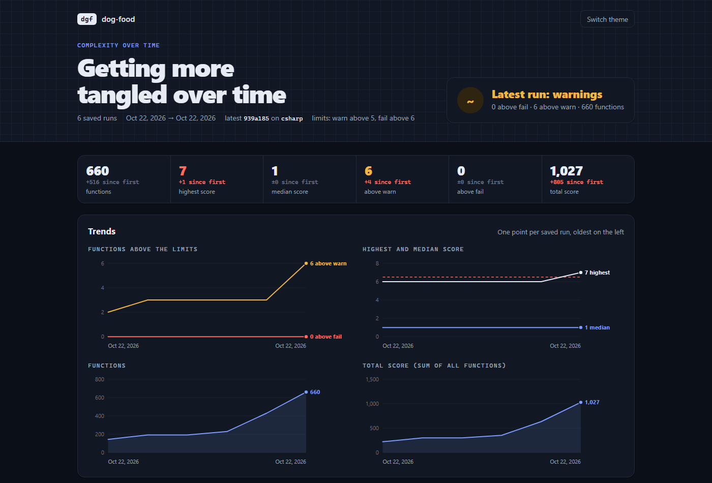

# Dashboards

Every report command can write one self-contained HTML page with `--format html -o <file>`. Each page works offline, follows the light or dark theme, and has a searchable table under its charts. The screenshots below are of this repository and its test projects.

| Page | Command | Question |
| --- | --- | --- |
| [Complexity](#complexity) | `dgf analyze --format html -o dgf-report.html` | How tangled is this code? |
| [Changes](#changes) | `dgf changes --format html -o dgf-changes.html` | What did this branch do? |
| [History](#history) | `dgf history --format html -o dgf-history.html` | Where is this code heading? |
| [Mutation](#mutation) | `dgf mutate --run --format html -o mutation.html` | Would the tests notice a bug? |
| [Duplication](#duplication) | `dgf dup --format html -o dup.html` | What can be united? |

## Complexity

- **Totals**: functions, highest and median score, how many are above warn and fail.
- **Score distribution**: functions per score, with the warn and fail limits drawn in.
- **Status** and **what drives complexity**: the share within limits, and which constructs add the most (`if`, `&&`, `match` arms, loops).
- **Size versus complexity**: every function as a dot, lines across, score up. Long and branchy ones sit top right.
- **Complex and untested** (with `--coverage`): coverage against score. The shaded corner is a CRAP score above the limit.
- **Hotspots by file**: each square a function, most complex first.

## Changes

- **Totals**: changed files and functions, new, worse, better, removed, the net score change, and the verdict.
- **Before and after**: each changed function as a hollow dot (before) and a filled dot (after), against the limits.
- **Changed functions**: the table, filtered by new, worse, better or the same.

Only new or worse functions above the limit fail `dgf changes`.

## History

Built from runs saved with `dgf analyze --save-history`, for example on every merge to main.

- **Trends**: functions above the limits, the highest and median score, the number of functions and the total score, one point per run.
- **Biggest movers**: the functions that got more complex, and those that got simpler, since the first run.

## Mutation

- **Totals**: the mutation score (detected ÷ detected, survived and no tests), killed, survived, no tests, timeouts, from the cache.
- **Not caught by any test**: each mutant as the change it made (`>=` → `>`), why it survived ("tests still pass" or "no test runs this"), its function and line. Each one is a test to add or sharpen.
- **By function**: the score of each function, next to its complexity.

More: [mutation testing](mutation/README.md).

## Duplication

A review page as well as a report: groups are marked *to fix*, *intentional* or *false positive*, and the decisions go back into the scan. See [reviewing in the dashboard](duplication/review.md).

## Other formats

The same data, for other readers: `markdown` (PR comments, CI summaries), `json` (other tools), `sarif` (GitHub code scanning), `agent` (AI assistants). See [output formats](commands.md#output-formats).
