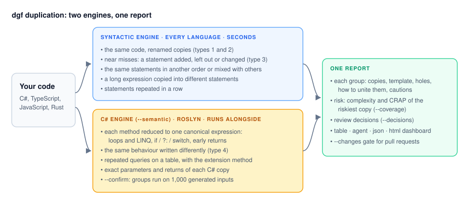

# Duplication

`dgf duplication` (short: `dgf dup`) finds code that can be united and says how. It reads C#, TypeScript/JavaScript and Rust. The same tool also installs on its own as `dgf-dup`, with the same arguments.



## What it finds

| Kind | Example | Engine |
| --- | --- | --- |
| **Type 1**: the same code | a method pasted into another class | syntactic |
| **Type 2**: renamed | the same loop over `plan.Price` and `seat.Fee` | syntactic |
| **Type 3**: a near miss | one copy has an extra `if (qty == 0) continue;` | syntactic |
| **Reordered or mixed in** | the same 5 statements in another order, with logging between them | syntactic |
| **Repeated statements** | `if (dto.X != null) user.X = dto.X;` for 12 fields | syntactic |
| **Type 4**: the same behaviour, written differently | a `foreach` that adds up, and `.Sum(...)` | C# engine |
| **Repeated queries on a table** | `o.ShopId == shopId && !o.IsDeleted` in 6 queries | C# engine |

Every finding comes with what to do: the shared template, what each copy fills in, where the shared version goes, and what to watch out for.

## Quick start

```powershell
dgf dup                                   # the current folder, biggest wins first
dgf dup src --top 10                      # the ten biggest
dgf dup --format html -o dup.html         # the review dashboard
dgf dup --semantic                        # add the C# engine (install it first: see below)
dgf dup --coverage TestResults            # rank by risk: the CRAP score of the riskiest copy
dgf dup --changes --fail-on-copies        # a PR gate: exit 1 when the branch adds a copy
```

Test code and migrations are left out unless you pass `--tests`. Generated files are always left out (`*.g.cs`, `*.designer.cs`, and files whose first lines say `<auto-generated>`, `@generated` or "DO NOT EDIT").

## Installing

`dgf dup` comes with `dgf` ([install](../install.md)). Installed with `dotnet tool install -g dgf`, the C# engine for `--semantic` comes with it. With `dgf` built from source, install the engine on its own:

```powershell
dotnet tool install -g dgf-dup-cs
```

## In this section

| Page | What it covers |
| --- | --- |
| [Reading a finding](findings.md) | every line of a finding: type, template, holes, unite advice, cautions, risk |
| [Reviewing in the dashboard](review.md) | the HTML page, marking groups, decisions in CI, the `--changes` gate |
| [How the syntactic engine works](how-it-works.md) | shapes, seeds, near misses, reordered statements, long expressions, what is left out |
| [The C# engine](csharp.md) | type 4, how projects are compiled, `--confirm`, `--compare`, exact extraction signatures |
| [Repeated queries](queries.md) | LINQ queries on a table and the extension methods that replace them |
| [Accuracy](accuracy.md) | the labelled corpus, precision on real code, speed |

Every option: `dgf dup --help`, or [the command reference](../commands.md#dgf-duplication).
