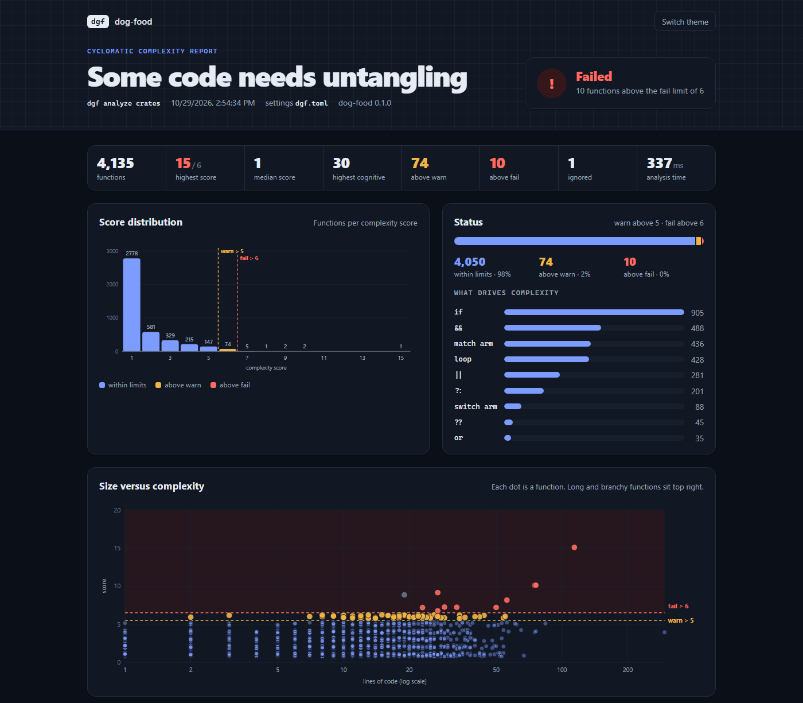

# dog-food (`dgf`)

**Find the code that is hard to change safely, and why.** A command-line code-health tool for C#, TypeScript, JavaScript and Rust: cyclomatic and cognitive complexity, CRAP scores, mutation testing and duplicate code detection, in one fast native binary. It runs locally and in CI, and needs no server or account.

This is a .NET tool you run from the terminal, not a library: it adds no reference to your project and changes none of your files. Only `dgf mutate --run` (in a copy of your code) and `dgf dup --confirm` (on generated inputs) run your code.

## Why use it

Tests can pass without noticing a bug, and code written quickly, by people or by AI assistants, can pass review while getting harder to change. `dgf` shows where:

| Question | Command | What you get |
| --- | --- | --- |
| Which functions are too complex, and which of those are untested? | `dgf analyze` | Cyclomatic and cognitive complexity, nesting, size, and the CRAP score from your coverage reports (Cobertura, OpenCover, LCOV) |
| Did this branch make anything worse? | `dgf changes` | Before-and-after scores of only the changed functions, as a PR gate or a pre-commit hook |
| Would the tests notice a bug? | `dgf mutate --run` | The small deliberate bugs no test caught, and the tests to extend |
| What is copied, and how do I unite it? | `dgf dup` | Exact and renamed copies and near misses, each with the shared template; for C#, methods that do the same thing written differently (a loop and its LINQ) and repeated database queries |



## Get started

You need the [.NET 10 SDK](https://dotnet.microsoft.com/download/dotnet/10.0).

```powershell
dotnet tool install -g dgf
cd your-repo

dgf analyze                                    # every function, worst first
dgf analyze --format html -o dgf-report.html   # the same, as a dashboard
dgf changes                                    # only what your branch changed
dgf dup                                        # copied code, biggest wins first
dgf mutate --changes --run                     # would the tests catch a bug in what you changed?
```

To pin a version for a repository and its CI, install it as a local tool:

```powershell
dotnet new tool-manifest
dotnet tool install dgf
dotnet tool run dgf analyze
```

## What it works with

| | C# | TypeScript / JavaScript | Rust |
| --- | :-: | :-: | :-: |
| Complexity and CRAP | ✓ | ✓ | ✓ |
| Branch checks | ✓ | ✓ | ✓ |
| Mutation testing | ✓ xUnit, NUnit, MSTest | ✓ Vitest, Jest, Angular | lists mutants, no test runs |
| Duplication | ✓ with the Roslyn engine | ✓ | ✓ |

- **Reports:** terminal tables, self-contained HTML dashboards, Markdown for PR comments and CI summaries, SARIF for GitHub code scanning, JSON, and a compact format for AI assistants.
- **Integrations:** CI gates through exit codes, a VS Code extension and a Claude Code skill.
- **Adoption:** a baseline accepts today's code, so only new problems fail.
- **Speed:** the tool's command is the native binary (written in Rust), so nothing starts up in .NET first. An install downloads only the binary for your platform: Windows, Linux or macOS, on x64 or arm64.

## Documentation

- [Project overview](https://github.com/bojanrmv/bt-dog-food#readme)
- [Set up a repository](https://github.com/bojanrmv/bt-dog-food/blob/main/docs/setup-in-another-repo.md)
- [Command reference](https://github.com/bojanrmv/bt-dog-food/blob/main/docs/commands.md)
- [Mutation testing](https://github.com/bojanrmv/bt-dog-food/blob/main/docs/mutation/README.md)
- [Duplication](https://github.com/bojanrmv/bt-dog-food/blob/main/docs/duplication/README.md)
- [Issues](https://github.com/bojanrmv/bt-dog-food/issues)

MIT licensed.
